# spatial-id

時空間IDを扱う Rust ライブラリです。
仕様は [4次元時空間情報基盤 ガイドライン（IPA）](https://www.ipa.go.jp/digital/architecture/guidelines/4dspatio-temporal-guideline.html)に準拠しています。

## 機能

### 空間ID・時空間IDの型定義

| 型                | 表すもの                               | 例                                         |
| :---------------- | :------------------------------------- | :----------------------------------------- |
| `SingleId`        | 1つの空間ID                            | `25/0/29800549/13205107`                   |
| `RangeId`         | 各次元を範囲で指定した空間IDのまとまり | `24/0:3/14900274:14900277/6602553:6602555` |
| `SpatialIdSet`    | 空間IDの集合                           |                                            |
| `SpatialIdMap<V>` | 空間IDごとに値を持つマップ             |                                            |

```rust
use spatial_id::{RangeId, SingleId};

// 25/0/29800549/13205107
let id = SingleId::new(25, 0, 29800549, 13205107)?;

// 24/0:3/14900274:14900277/6602553:6602555
let range = RangeId::new(24, [0, 3], [14900274, 14900277], [6602553, 6602555])?;

// 12/0/3638/1614_1800/809712
let id = SingleId::new(12, 0, 3638, 1614)?.time_with(1800, 809712)?;
```

時間を扱うかどうかは `temporal_id` feature で切り替えます（[詳細](docs/temporal-id-feature.md)）。

## 図形から空間IDへの高精度な変換

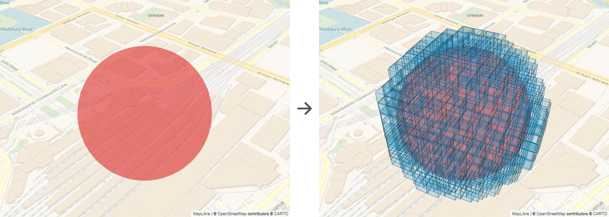

```rust
use spatial_id::geometry::{Coordinate, CoverSingleIds, Sphere};

let center = Coordinate::new(35.681236, 139.767125, 50.0)?; // 緯度, 経度, 高度[m]
let sphere = Sphere::new(center, 30.0)?;                     // 半径 30 m
let set = sphere.cover_set(25)?;                             // ズームレベル 25 の空間IDの集合
```

ほかの図形も同じように変換できます。

|            `Coordinate`             |               `Line`                |
| :---------------------------------: | :---------------------------------: |
|  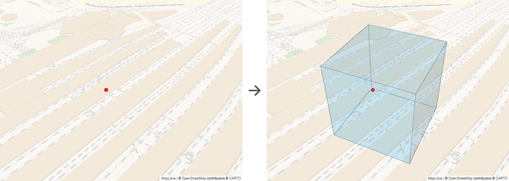   |   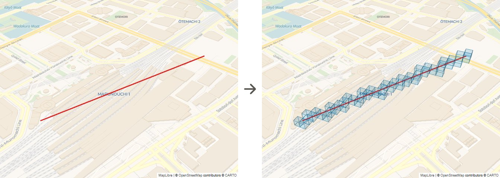   |
|           **`Triangle`**            |            **`Polygon`**            |
| 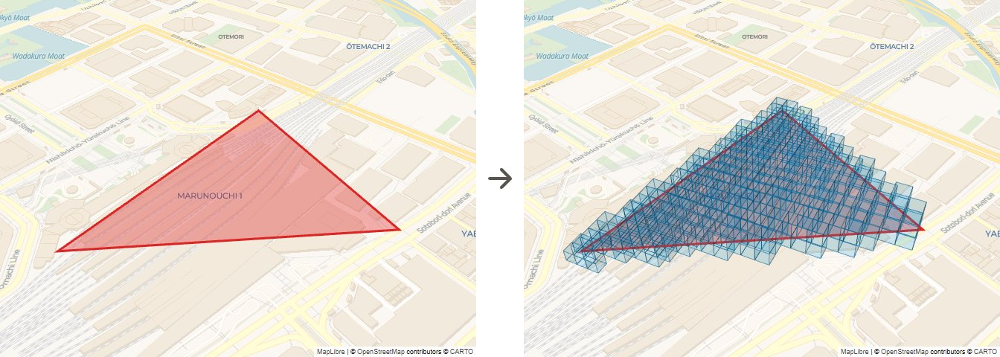 | 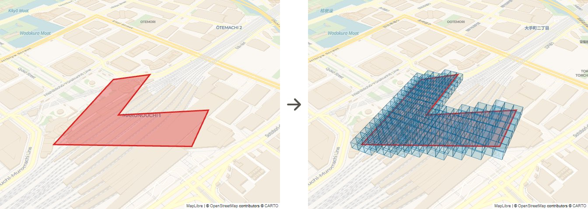  |
|             **`Solid`**             |           **`Cylinder`**            |
|  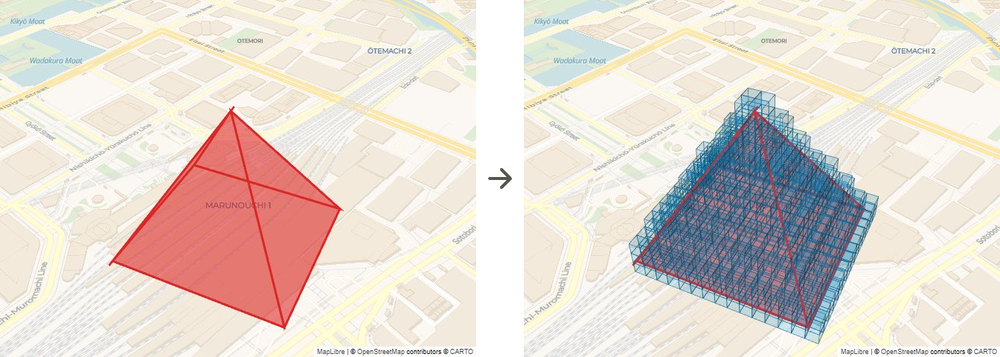   | 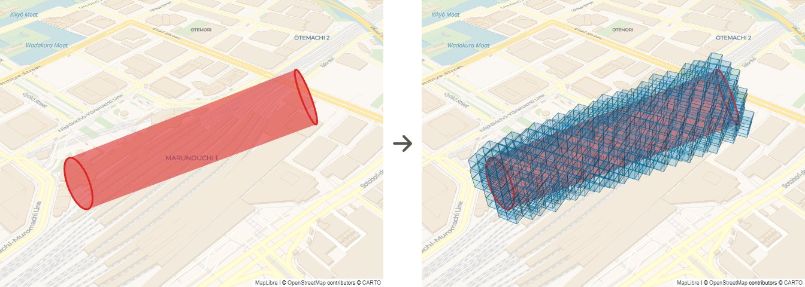 |
|             **`Tube`**              |       **`geojson::GeoJson`**        |
|   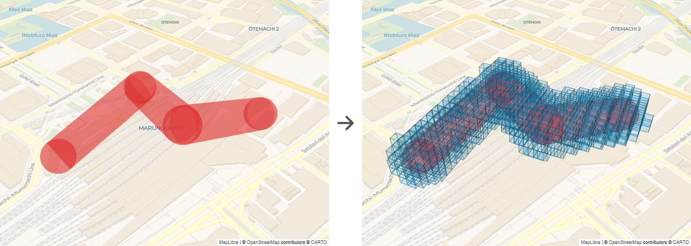   | 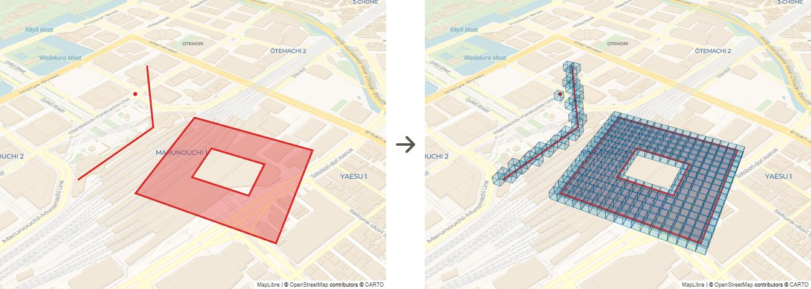  |

## 時空間データの加工

例えば、道路と建物のリスク値を、それぞれ押し出して拡散させ、1枚のリスクマップに重ね合わせることができます。

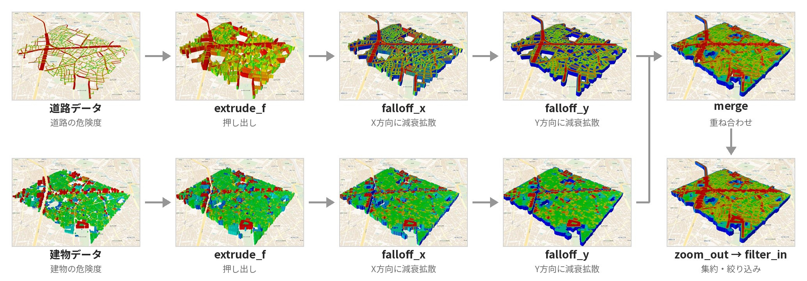

```rust
let tran_risk = tran
    .query()
    .extrude_f(25, 0, 50, Max)
    .falloff_x(25, 10, None, FalloffPattern::QuadraticIn, Max)
    .falloff_y(25, 10, None, FalloffPattern::QuadraticIn, Max);

let bldg_risk = bldg
    .query()
    .extrude_f(25, 0, 50, Max)
    .falloff_x(25, 10, None, FalloffPattern::QuadraticIn, Max)
    .falloff_y(25, 10, None, FalloffPattern::QuadraticIn, Max);

let risk = bldg_risk
    .merge(tran_risk, Max)
    .zoom_out(23, Average)
    .filter_in(0..100)
    .get(..)
    .into_map()?;
```

サンプルデータ（`sample/riskmap/`）で実際に動かせます。結果は `riskmap.json` に出力されます。

```sh
cargo run --release --example riskmap --features unstable
```

### 結果

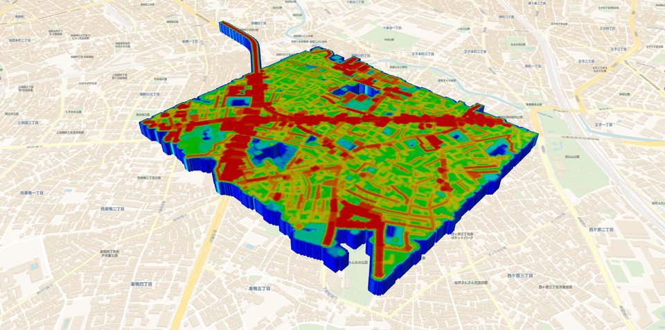

## インストール

```toml
[dependencies]
spatial-id = "0.1"
```

| feature       | default | 内容                                           |
| :------------ | :-----: | :--------------------------------------------- |
| `std`         |    ✓    | 標準ライブラリを使う。GeoJSON からの変換に必要 |
| `rayon`       |    ✓    | 並列実行                                       |
| `temporal_id` |    ✓    | 時空間ID。無効にすると空間IDのみ               |
| `unstable`    |         | JSON 入出力など、破壊的変更があり得る API      |
| `random`      |         | ランダムな空間IDの生成                         |
